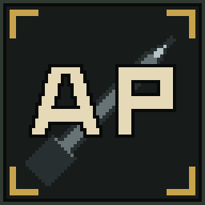

<p align="center">
  
</p>

<h1 align="center">装甲先锋 · Armor Pioneer</h1>

<p align="center">
  <b>《战术小队》风格的装甲等效</b> + <b>《战争雷霆》风格的剩余穿深</b>，为 Minecraft 载具模组「永无止境：载具」而作。
</p>

<p align="center">
  
  
  
  
</p>

---

## 简介

本仓库包含两个部分：

| 部分 | 说明 |
|---|---|
| **附属模组** `ywzj_vehicle_armor` | 装甲等效、剩余穿深、弹药分架、乘员分工、可调悬挂、涉水、混动、烟雾分组等全部机制 |
| **载具包** `armor_pioneer`（装甲先锋） | 7 辆主战坦克：VT-5、VT-4、K2、10 式、天马-20、ZTZ-100、豹2A4 |

两者都需要基础模组 **「永无止境：载具」(`ywzj_vehicle`) 0.6.3 或更高版本**。载具包本身可用于任意载具包，附属模组为 43 辆载具预置了装甲数值。

> 这是一个**配置驱动**的模组：所有装甲厚度、倍率、弹药穿深都在 `config/ywzj_vehicle_armor.json` 里，加一辆车只需要加一段配置，不需要改代码。默认值是一份带文献依据的初稿，可以自由修改。

## 主要特性

### 装甲与伤害

- **逐板装甲等效**：炮塔正面、首上、首下、侧面、后部、顶部、底部各有独立数值；炮根弱点和履带区按几何判定。
- **弹种分离**：同一辆车对穿甲弹、破甲弹、高爆弹有三套厚度（`profile` 覆盖）。
- **剩余穿深结算**：`伤害 = (穿深 − 装甲) × 该部位倍率`，打不穿就是跳弹，不掉血。
- **爆炸反应装甲**：按血量消耗，打光后露出后面的主装甲；串联战斗部克制它。
- **复合装甲方向模型**：装甲值随入射角变化，而非单一常数。
- **动能破片 / 化学破甲 / PELE / 穿甲榴弹（APHE）**：不同弹种各自的二次伤害模型。
- **KSTAM-II 攻顶**：K2 的攻顶弹在车顶上方引爆，向下攻击顶部装甲。
- **原版武器、爆炸、碰撞**同样走装甲表：剑斧弓弩、TNT、苦力怕、撞墙与硬着陆都能被装甲挡下或放大。
- **TACZ 兼容（可选）**：子弹按实际伤害换算穿深；不装 TACZ 一切照旧。
- **装甲扫描仪**：手持扫描仪读取任一载具的分区装甲。

### 乘员与操控

- **乘员分工**：驾驶员、炮手、车长各司其职，能力由座位与武器决定，不依赖部件名字。
- **车长接管**：车长可以接管主炮瞄准；炮手失能时车长可代射。
- **驾驶接管**：车长可以随时接过方向盘。
- **液气悬挂**（9 辆）：调车高、前后俯仰，K2 与 10 式还能左右压车体。
- **涉水套件**：T-64 的 OPVT 通气管，按 `K` 展开。
- **混动系统**：ZTZ-100 的柴油 / 纯电切换，按 `G`。
- **烟雾弹分组**：按排发射，一组四发，3 组轮换。
- **热成像与夜视**：装甲先锋七辆的炮手镜。
- **弹药合集与装填选择**：左 Alt 选择弹种，各型火炮有分档开火特效。
- **吨马力加速倍率**：发动机功率 / 重量直接影响加速与转向，HUD 显示。

### 装甲先锋载具包

7 辆主战坦克，统一的操控、装甲与乘员规则：

**VT-5** · **VT-4** · **K2** · **10 式** · **天马-20** · **ZTZ-100** · **豹2A4**

每辆都有：逐板装甲表、炮手镜热成像/夜视、烟雾弹、可调悬挂，VT-5 / VT-4 / K2 另有一对牵引钩，ZTZ-100 另有混动系统。

## 支持的载具

当前共有 **43 辆载具**配有装甲数值，跨四个载具包：

| 载具包 | 数量 | 载具 |
|---|---:|---|
| `vvp_ywzj`（VVP） | 11 | T-64、T-72B3M、T-90M ×3（基础 / 突破 2022 / 突破 2024）、BTR-3、M1 系列 ×4（M1A1 / M1A2 / M1A1 SA 乌克兰 / M1A2 SEP）、M1296「龙骑兵」 |
| `tank_assault`（坦克突击） | 24 | 21 辆地面载具（豹式 G、虎式 E、丘吉尔 VII、玛蒂尔达 I、瓦伦丁 II、17 磅炮、25 磅炮、四号 H、斐迪南、突击虎、Sd.Kfz.251、Sd.Kfz.2、BMW R75、82 型桶车、BT-7、T-26、KV-1 1942、T-34-85、T-44、SU-122、P26/40）+ 3 架战机（Bf 109E-4、Fw 190A-5、P-51D-20） |
| `armor_pioneer`（装甲先锋） | 7 | VT-5、VT-4、K2、10 式、天马-20、ZTZ-100、豹2A4 |
| `wks_6`（抗战载具包） | 1 | 维克斯 6 吨（Vickers 6-Ton Type B） |

另有 6 辆（BMP-3、BRM-3K、9K123「菊花」、挑战者 2、美洲狮、阿贾克斯）只配了液气悬挂，没有装甲条目。

完整数值见 [docs/默认数值.md](docs/默认数值.md)。

## 安装

### 1. 安装附属模组

1. 从 [releases/](releases/) 下载对应平台的 jar：
   - Minecraft 1.20.1 / Forge → `ywzj_vehicle_armor-2.0.22.jar`
   - Minecraft 1.21.1 / NeoForge → `ywzj_vehicle_armor-2.0.2-1.21.1.jar`
2. 放进版本隔离目录下的 `mods/`（例如 `.minecraft/versions/1.20.1-Forge_47.4.2/mods/`）。
3. **删除同 modId 的旧版本**：同一个 `ywzj_vehicle_armor` 同时存在两份会导致启动失败。
4. 确认同目录下已有 `ywzj_vehicle-<平台>-0.6.3.jar`。
5. 启动游戏，`config/ywzj_vehicle_armor.json` 会自动生成；旧配置文件会就地升级，手改过的数值不会被覆盖。

### 2. 安装装甲先锋载具包

把 [releases/armor_pioneer-1.1.7.zip](releases/) 放进 `limitless_vehicle/` 即可，也可以解压成文件夹放进去。

> ⚠️ **同一命名空间只能存在一个包。** 文件夹 `armor_pioneer-1.1.7-0.6.3/` 和 `armor_pioneer-1.1.7.zip` 同时存在时，基础模组只加载扫描到的第一个，另一个会打一行 `Duplicated namespace` 日志。换包时请把旧的移出目录，而不是改个后缀留在原地。

详细安装说明（含配置升级、常见问题）见 [docs/安装.md](docs/安装.md)。

## 键位速查

所有键位都是标准 `KeyMapping`，可在 **选项 → 控制 → 按键设置 → 装甲附属** 中改绑。

| 动作 | 默认键 | 说明 |
|---|---|---|
| 装填选择 / 俯仰修饰键 | **左 Alt** | 轻按打开装填选择；按住时配合前进 / 后退调车体俯仰 |
| 车体升高 / 扫描仪上页 | **↑** | 扫描仪在手上时翻页 |
| 车体降低 / 扫描仪下页 | **↓** | 同上 |
| 悬挂左倾 / 引信切换 | **←** | K2、10 式的驾驶员是侧倾 |
| 悬挂右倾 / 引信延时 | **→** | 同上 |
| 涉水套件 | **K** | 仅驾驶员 |
| 舱盖开合 | **P** | 开关最近的舱盖 |
| 混动模式 | **G** | 仅 ZTZ-100 |
| 夜视仪 | **5** | 装甲先锋炮手镜 |
| 舱盖潜望镜 | **Y** | 车长席 |

方向键与 `G` 和基础模组共用，出现红色冲突提示是正常的。完整说明见 [docs/键位.md](docs/键位.md)。

## 版本与平台支持

| 平台 | 附属模组版本 | 加载器 | 基础模组 | `CONFIG_VERSION` | 状态 |
|---|---|---|---|---|---|
| Minecraft 1.20.1 | **2.0.22** | Forge 47.x | `ywzj_vehicle` 0.6.3+ | 110 | 功能完整，主开发分支 |
| Minecraft 1.21.1 | **2.0.2-1.21.1** | NeoForge 21.1 | `ywzj_vehicle` 0.6.3+ | 91 | 独立移植，跟踪 2026-11-18 的状态 |

两个分支是**相互独立的两棵源码树**，不是同一份代码的两个编译目标。1.21.1 分支目前**尚未移植** 2.0.10 之后加入的若干特性（KSTAM 攻顶、PELE、穿甲榴弹、复合装甲方向模型、原版爆炸与碰撞接管等），移植记录见 [docs/1.21.1-移植说明.md](docs/1.21.1-移植说明.md)。两个分支的 `CONFIG_VERSION` 数字不同并不代表内容一一对应。

## 构建

构建脚本直接调用 `javac` 对着游戏实际加载的基础模组 jar 编译，**不依赖 Gradle**，因此需要一台已经装好 Forge / NeoForge 与基础模组的机器。

```powershell
# Minecraft 1.20.1 / Forge
cd addon/1.20.1-forge
powershell -ExecutionPolicy Bypass -File build.ps1     # 产物在 build/libs/
powershell -ExecutionPolicy Bypass -File verify.ps1    # 42 项自检

# Minecraft 1.21.1 / NeoForge
cd addon/1.21.1-neoforge
powershell -ExecutionPolicy Bypass -File build1211.ps1
python tools/mixin_audit.py                             # 28 个 Mixin 目标，0 问题
powershell -ExecutionPolicy Bypass -File verify1211_addon.ps1
```

脚本默认在 `E:\.minecraft` 下查找依赖，可用环境变量 `MC_ROOT`、`YWZJ_JAR`、`TACZ_JAR` 覆盖。**必须对着游戏真正加载的那个 `ywzj_vehicle-*.jar` 编译**：`build.ps1` 会自动挑实例 `mods/` 里最新的那个。

完整构建说明见 [docs/构建.md](docs/构建.md)。

## 仓库结构

```
armor_pioneer/
├── addon/
│   ├── 1.20.1-forge/          # 1.20.1 源码树（src/、tools/、build.ps1、verify.ps1）
│   └── 1.21.1-neoforge/       # 1.21.1 源码树（独立移植，Mojang 官方名 + NeoForge 网络）
├── pack/
│   ├── armor_pioneer/         # 装甲先锋载具包（assets/、data/、vehicle_pack.meta.json）
│   └── patchers/              # 1.0.0 时代的旧载具包补丁脚本（仅存档参考）
├── docs/                      # 机制、配置、默认数值、构建等完整文档
├── releases/                  # 已构建的 jar 与载具包 zip（含 SHA256SUMS.txt）
├── CHANGELOG.md               # 版本更新日志
├── LICENSE                    # 许可与第三方声明
└── README.md
```

## 文档

| 文档 | 内容 |
|---|---|
| [安装](docs/安装.md) | 安装步骤、配置升级、载具包格式 |
| [键位](docs/键位.md) | 全部按键与冲突说明 |
| [机制](docs/机制.md) | 装甲、穿深、爆反、溅射、乘员、悬挂等全部规则 |
| [默认数值](docs/默认数值.md) | 43 辆载具的装甲表与弹药穿深 |
| [配置](docs/配置.md) | `config/ywzj_vehicle_armor.json` 逐项说明 |
| [适配新载具](docs/适配新载具.md) | 加一辆车需要准备哪些数据、怎么量 |
| [验证](docs/验证.md) | 怎么确认模组真的生效了 |
| [载具包改动](docs/载具包改动.md) | 附属模组会对载具包做哪些改动 |
| [兼容性](docs/兼容性.md) | 历代基础模组适配说明 |
| [1.21.1 移植说明](docs/1.21.1-移植说明.md) | NeoForge 移植的技术记录 |
| [构建](docs/构建.md) | 构建环境、编译依赖、自检套件 |
| [实现说明](docs/实现说明.md) | 代码结构与关键设计 |
| [已知限制](docs/未覆盖.md) | 尚未覆盖或刻意简化的部分 |
| [更新日志](CHANGELOG.md) | 版本变更 |

## 已知限制（摘要）

- 环境伤害（火焰、岩浆、闪电）尚未纳入装甲结算。
- VVP 的 64 辆车中目前只配了 11 辆。
- 三架飞机的装甲数值是量级估算，且没有起火、操纵面损伤。
- 涉水套件只有 T-64 有；T-72B3M 的装甲是初稿。
- 碰撞伤害只接管了装甲先锋的 7 辆车。
- 1.21.1 分支尚未在游戏内逐项验证 2.0.10+ 特性的等价行为。

完整清单与原因见 [docs/未覆盖.md](docs/未覆盖.md)。

## 许可与致谢

本仓库内容 **保留所有权利（All Rights Reserved）**，详见 [LICENSE](LICENSE)。

- 基础模组 **「永无止境：载具」(`ywzj_vehicle`)** 为必需依赖，不包含在本仓库中。
- 装甲先锋载具包在模型层面衍生自 `dragonrise_reforge_ywzj` 的 ZTQ-15，该包未随附许可证；相关权利归原作者所有。

如需在整合包中分发、二次修改或商用，请先与作者联系。
