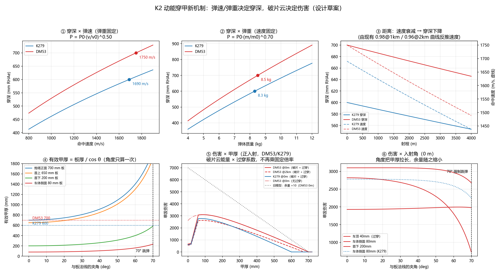
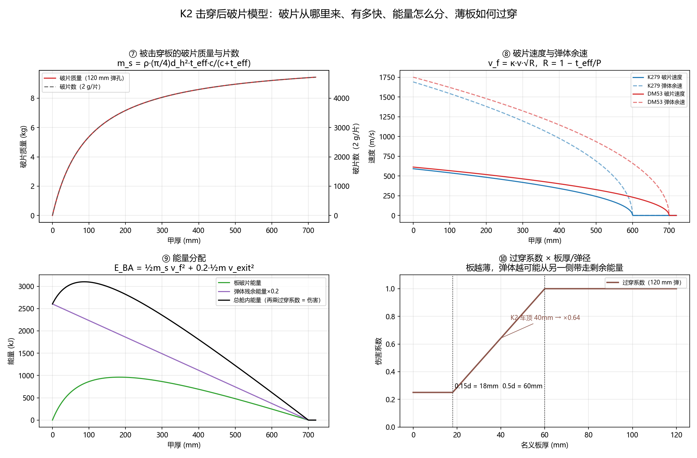
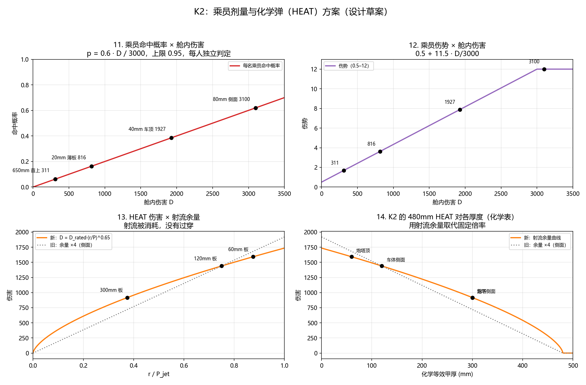
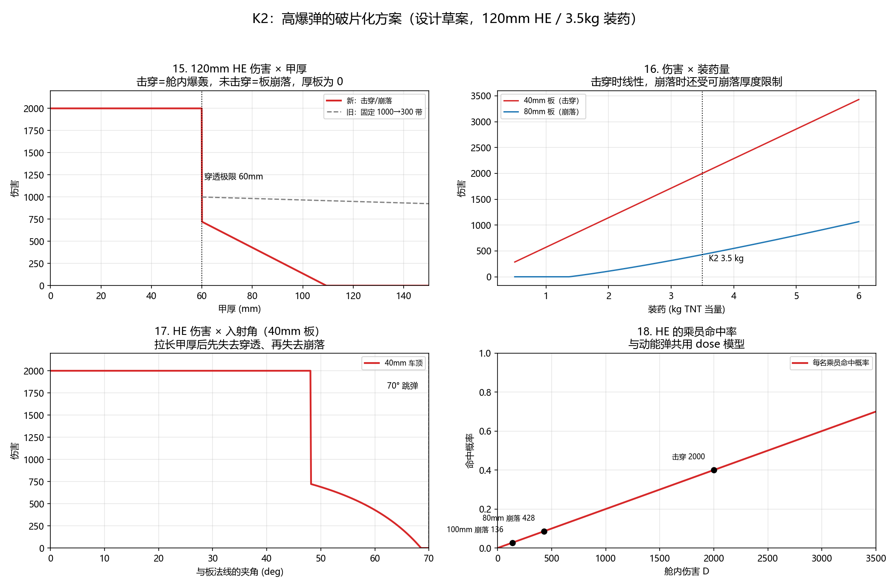

# 动能穿甲新机制（已实装）

**试验对象：K2 Black Panther（`armor_pioneer:k2`）**

四个部分：**穿深**（弹速/弹重）、**伤害**（击穿后破片云 + 薄板过穿）、**乘员剂量**、
**化学弹**（HEAT 射流余量；HE 击穿爆轰 / 未击穿板崩落）。固定伤害倍率与固定装药伤害
都不再使用。

> **实装状态（2.0.20）**：四部分全部实装。动能模型挂在 K2 的 K279/DM53 和 VT-4 的
> BTA4/DTC10E 四发钢针上（2.0.17）；化学模型挂在 K2 120mm HEAT / HE、VT-4 125mm
> HEAT / HE、KSTAM EFP 五发弹上，乘员剂量对**所有**击穿生效（2.0.18）；
> 横向效应弹 BTS8 另走 `PeleModel`（2.0.19）；虎式的 PzGr 39 是 **APHE** ——
> 破片伤害 + 弹底装药内爆（`charge_kg` × 封闭系数），PzGr 40 与 Sprgr 43 同批实装
> （2.0.20）；装甲先锋其余五辆（VT-5、Type 10、天马-20、ZTZ-100、豹2A4）的炮弹在
> 2.0.21 全部迁入，并在 2.0.22 取得方向系数（复合等效 + 来袭角度）。其它包、其它弹仍走旧公式——
逐弹启用，不是全局切换。

---

## 1. 数据流

```
            ┌─ 弹速 v ──┐
            │           ├─→ P = P0 · (m/m0)^α · (v/v0)^β
            └─ 弹重 m ──┘                    │
                                             ▼
                              ┌──  R = (P − t/cosθ) / P  ──┐
                              │                            │
        ┌─ 甲厚 t ─→ t_eff = t / cosθ ──┘                    │
        └─ 角度 θ ─→ θ ≥ 70° 先判跳弹                          │
                                                             ▼
                    R < 0 ：未击穿，动能弹伤害 0
                    R ≥ 0 ：破片能量 E_BA = ½m_s·v_f² + λ·½m·v_exit²
                             过穿系数 s(t/d)
                             伤害 D = E_BA / E_UNIT × s
```

角度只进 `t / cosθ`（等效厚度）；过穿系数只看**名义板厚与弹径之比**，两者不重复。

---

## 2. 穿深：弹速与弹重

```
P(v, m) = P0 · (m / m0)^α · (v / v0)^β
```

- `P0` 仍是 `penetration` 字段里的评级（K279 600、DM53 700），代表在标定点 `(m0, v0)` 上的水平。
- 长杆：α = 0.70、β = 0.50；全口径 AP：0.50 / 1.00；APCR：0.50 / 1.00。
- β = 0.5 与现有「1 km 保留 98%」曲线自洽：反推速度每公里掉 4%。

---

## 3. 甲厚与角度

```
t_eff = t / cos θ        θ = 与板法线的夹角
跳弹：θ ≥ 70°（沿用现有 ricochet_angle，在外挂层之后判定）
```

---

## 4. 伤害：破片云 + 过穿

### 4.1 破片质量与速度

```
d_h = 1.1 · 弹径                        120mm 弹 → 132mm 弹孔
m_s = ρ · (π/4)d_h² · t_eff · c/(c+t_eff)      ρ = 7850 kg/m³, c = 100 mm
v_f = κ · v · √R                         κ = 0.35
v_exit = v · √R                          弹体穿板后的余速
```

`c/(c+t_eff)` 是约束系数：薄板花瓣式外翻、材料大量抛出；厚板把材料约束在洞里。

### 4.2 舱内能量

```
E_BA = ½ · m_s · v_f²  +  λ · ½ · m · v_exit²        λ = 0.2
```

板破片是面杀伤，弹体只走一条窄通道，所以弹体余能只计 20%。

### 4.3 过穿：薄板挡不住弹体

板厚不到弹径一半时，弹体既不会被减速，也不会翻滚，直接从另一侧离开，把大部分剩余能量
带走。舱内只剩下板本身溅出的少量破片：

```
u = t / d                                名义板厚 / 弹径
over = clamp((0.50 − u) / (0.50 − 0.15), 0, 1)
s = 1 − over · (1 − 0.25)
D = E_BA / E_UNIT · s
```

- **0.5d 开始过穿**：120mm 弹约 **60mm**；**0.15d 完全过穿**：约 **18mm**。
- 完全过穿时只保留 **25%** 的舱内能量（`s = 0.25`）。
- 门槛看**名义板厚**，不看 `t_eff`：一块 40mm 板斜着放仍然是"薄板"，角度只通过
  `t_eff` 改变破片与余量。这样不会出现"把薄板摆个角度反而更容易被打穿"的反直觉结果。

### 4.4 没有固定倍率了

旧模型 `D = 余量 × M_face` 里的 ×10 / ×5 被整项去掉。现在：

| 甲厚（DM53，120mm） | 过穿系数 | 舱内能量 | 最终伤害 |
|---|---|---|---|
| 10 mm | 0.25 | 2 748 kJ | 687 |
| 20 mm | 0.29 | 2 856 kJ | 816 |
| 35 mm | 0.55 | 2 970 kJ | 1 644 |
| 40 mm | 0.64 | 2 998 kJ | 1 927 |
| 60 mm | 1.00 | 3 072 kJ | 3 072 |
| **80 mm** | **1.00** | **3 099 kJ** | **3 100** |
| 100 mm | 1.00 | 3 095 kJ | 3 096 |
| 200 mm | 1.00 | 2 819 kJ | 2 820 |
| 400 mm | 1.00 | 1 807 kJ | 1 807 |
| 650 mm | 1.00 | 311 kJ | 311 |
| 700 mm | — | 0 | 0 |

曲线现在是**两头低、中间高**：薄板过穿（伤害 700–1 900），80–100mm 的板破片最多而余速
还高（约 3 100，这是校准点），接近弹道极限时余速趋零（650mm 只剩 311，700mm 归零）。

`E_UNIT ≈ 1 kJ / 点伤害`，校准点是 **DM53 打 K2 车体侧面 80mm 正入射 = 3100**，
与旧模型 `620 × 5` 一致——新模型改变的是曲线形状，不是基准平衡。

### 4.5 乘员伤害：同一份舱内剂量

乘员不再按"余量/10"估算，而是直接吃上面的最终伤害 `D`。破片云与过穿已经把所有四个
输入算进去了，乘员只需再回答两个问题：**打不打得到**、**打得有多重**。

```
dose  = D / crew_wound_reference          （默认 3000）
p_hit = min(0.95, exposure × dose)        （exposure 默认 0.6）
伤势  = clamp(0.5 + 11.5 × dose, 0.5, 12)
```

- 命中概率按**每名乘员独立判定**，破片锥不会覆盖整个舱室，所以乘了 0.6。
  一个满穿（D ≈ 3100）对每名乘员约 62%；一个被过穿的 40mm 车顶（D ≈ 1927）约 39%。
- 伤势沿用现有的 0.5–12 标度与失能时长；满穿直接到 12。
- 谁在名单里沿用现有 compartment 判定：被打中部件的主人优先，其余同舱室乘员依次判定。
- **受伤的驾驶员仍然会失去控制**（现有 `CrewState` 逻辑不变）。

| 命中 | D | 每人命中率 | 伤势 |
|---|---|---|---|
| 80mm 车体侧面（DM53） | 3 100 | 62% | 12 |
| 40mm 炮塔顶（DM53） | 1 927 | 39% | 7.9 |
| 20mm 薄板 | 816 | 16% | 3.6 |
| 650mm 首上（勉强穿透） | 311 | 6% | 1.7 |
| HEAT 120mm 车体侧面 | 1 440 | 29% | 6.0 |

这样"薄板过穿"不仅让车体少掉血，也让乘员更难被打中/打重——两层效果是同一个数。

---

## 5. K2 试验数值

| 弹 | P0 | m0 | v0 | 弹径 |
|---|---|---|---|---|
| K279 APFSDS | 600 mm | 8.3 kg | 1 690 m/s | 120 mm |
| DM53 APFSDS | 700 mm | 8.5 kg | 1 750 m/s | 120 mm |

### 5.1 距离

| 射程 | K279 速度 | K279 穿深 | DM53 速度 | DM53 穿深 |
|---|---|---|---|---|
| 0 m | 1 690 | 600 | 1 750 | 700 |
| 1 km | 1 623 | 588 | 1 681 | 686 |
| 2 km | 1 559 | 576 | 1 614 | 672 |

### 5.2 弹速 / 弹重（相对标定点）

| 变化 | K279 穿深 | DM53 穿深 |
|---|---|---|
| 速度 −10% | 569 | 664 |
| 标定 | 600 | 700 |
| 速度 +10% | 629 | 734 |
| 弹重 −20% | 513 | 599 |
| 标定 | 600 | 700 |
| 弹重 +20% | 682 | 795 |

### 5.3 DM53 打 K2 各面（0 m，正入射）

| 部位 | 甲厚 | 过穿系数 | 新伤害（破片 + 过穿） | 旧伤害（余量 × 倍率） |
|---|---|---|---|---|
| 炮塔正面 | 700 | 1.00 | 0 | 0 |
| 首上 | 650 | 1.00 | 311 | 500 |
| 首下 | 200 | 1.00 | 2 820 | 5 000 |
| 炮塔侧面 | 100 | 1.00 | 3 096 | 3 000 |
| 车体侧面 | 80 | 1.00 | 3 100 | 3 100 |
| 炮塔顶（40mm） | 40 | 0.64 | 1 927 | 3 300 |
| 车体顶（35mm） | 35 | 0.55 | 1 644 | 3 325 |

K279（600）对炮塔正面和首上完全不穿；对首下 200mm 约 2 417，车体侧面 80mm 约 2 779，
40mm 车顶约 1 746。

**主要变化**：首下从 5 000 降到 2 820；首上从 500 降到 311；车顶从 3 300 降到 1 927
（过穿）；侧面基本不变（校准点）。薄板不再是"被击穿就一定重创"，而是"打个洞穿过去"。

### 5.4 角度（DM53 打车体侧面 80mm，60mm 以上无过穿）

| 入射角 | 有效甲厚 | 伤害 |
|---|---|---|
| 0° | 80.0 | 3 100 |
| 15° | 82.8 | 3 101 |
| 30° | 92.4 | 3 101 |
| 45° | 113.1 | 3 080 |
| 60° | 160.0 | 2 966 |
| 69° | 223.2 | 2 722 |
| 70° | — | **0（跳弹）** |

40mm 车顶因为过穿系数固定为 0.64，各角度伤害都在 1 900 左右，直到 70° 跳弹归零。

### 5.5 距离（DM53 打首下 200mm）

| 射程 | 伤害 |
|---|---|
| 0 m | 2 820 |
| 500 m | 2 697 |
| 1 km | 2 580 |
| 2 km | 2 360 |
| 3 km | 2 158 |

---

## 6. 化学弹方案（提案）

化学弹不走弹速/弹重——射流速度约 8 km/s，质量与飞行速度不是决定穿深的那两个量。
但要取消固定倍率的话，两类弹的答案不一样：

### 6.1 HEAT：射流余量曲线

- **穿深**：`P_heat` 仍是配置里的固定值（K2 的 480mm），不随距离/弹速变化。
- **甲厚**：继续用 `heat` 表（K2：炮塔正 1150、首上 1050、首下/炮塔侧 300、车体侧 120…），
  `t_eff = t / cosθ`。动能弹的 `kinetic_angle_scaling` 不作用在化学弹上。
- **余量**：`r = P_heat − t_eff`。
- **伤害**：

```
D_heat = D_rated · (r / P_heat)^0.65
```

`D_rated` 是这发弹的额定舱内伤害（新字段），按现有伤害在代表性命中点上标定：
K2 的 480mm HEAT 打车体侧面 120mm → r=360 → 旧 360×4 = 1440，取 `D_rated = 1736`。

| K2 化学表 | 甲厚 | 新伤害 | 旧伤害（余量 × 倍率） |
|---|---|---|---|
| 炮塔正面 | 1150 | 0 | 0 |
| 首上 | 1050 | 0 | 0 |
| 首下 | 300 | 918 | 1 080 |
| 炮塔侧面 | 300 | 918 | 720 |
| 车体侧面 | 120 | 1 440 | 1 440 |
| 炮塔顶 | 60 | 1 592 | 1 680 |

- **HEAT 没有过穿**：射流在穿甲过程中被消耗，不会"从另一侧带着能量离开"。
- ERA 消耗、串联战斗部破 ERA 的规则完全不变。
- 角度：仍按 `t_eff = t / cosθ`；射流对斜角的敏感度低于长杆，如果实测太敏感，
  可以把指数从 1.0 降到 0.75（`t / cos^0.75 θ`），作为单独参数。

### 6.2 HE：舱内爆轰 / 板崩落，两种都是破片

高爆弹也去掉固定伤害。装药量是新的输入（`charge_kg`，TNT 当量），两种结果都由
**爆轰能量 × 钢板响应**算出来：

```
E_blast = C × 4.184 MJ/kg

击穿（P_he ≥ t_eff）：弹在舱内爆炸
    E_in = E_blast

未击穿：冲击波让板的内表面崩落（scabbing）
    t_scab = 72 × C^(1/3)  mm
    η      = 0.8 × clamp(1 − t_eff / t_scab, 0, 1)
    E_in   = η × E_blast

D = E_in / 7.322 kJ
```

- 校准：120mm HE、3.5 kg 装药在舱内爆炸 = **2000**，与现行固定值一致；
  也就是 7.322 kJ 舱内爆炸能量 ≈ 1 点伤害。
- `t_scab` 是可崩落极限：3.5 kg 装药约 **109mm**，更厚的板不会被崩落，
  **内部伤害为 0**（只剩致盲闪光）。这是本方案变化最大的一处：HE 从"打哪都掉血"
  变成**反顶部 / 反轻装甲**武器。
- 击穿与未击穿在 60mm 处有一个台阶（2000 → 707）：弹进去炸和在外面炸，本来就是两回事。
- 没有过穿（装药一碰到板就起爆，不存在"穿过去带走能量"）。

120mm HE（3.5 kg）对板的伤害：

| 板厚 | 结果 | 伤害 |
|---|---|---|
| ≤ 60 mm | 击穿，舱内爆轰 | 2 000 |
| 61 mm | 未击穿，板崩落 | 707 |
| 70 mm | 崩落 | 575 |
| 80 mm | 崩落 | 429 |
| 90 mm | 崩落 | 283 |
| 100 mm | 崩落 | 136 |
| ≥ 109 mm | 板太厚，不崩落 | 0 |

K2 的 HE 表：

| 部位 | 甲厚 | 伤害 |
|---|---|---|
| 炮塔正面 / 首上 | 1150 / 1050 | 0 |
| 首下 / 炮塔侧面 | 300 | 0 |
| 车体侧面 | 120 | 0 |
| 车体后部 | 90 | 283 |
| 履带端面 | 80 | 429 |
| 炮塔顶 / 车体顶 | 30 | 2 000 |

HE 只在**车顶、车底、履带端面和车尾**有内部效果；正面和侧面挨 HE 不掉内部血。
如果希望 HE 对重甲仍有少量外部冲击伤害，可以另加一个独立的 `external_blast`
分量，但它不再是"破片"，本方案没有加。

### 6.3 化学弹的乘员

同一个 dose 模型：`dose = D / 3000`。

- HEAT 满穿（1 440）对每人约 **29%**，伤势 6.0。
- HE 击穿（2 000）约 **40%**，伤势 8.2；80mm 崩落（429）约 **8.6%**，伤势 2.1；
  厚板 0 则无伤。
- 未击穿、未崩落的 HE 仍只给致盲闪光，不进入 dose。

### 6.4 KSTAM-II 攻顶：飞到车顶上方引爆

**基础模组已经有一半。** 包里 KSTAM 的 `guidance` 是 `PRESET`，已经带
`preset_cruise_altitude: 16`、`preset_ascent_distance: 32`、`preset_dive_distance: 40`：
导弹会爬升、平飞、再俯冲。缺的是**在哪引爆**和**引爆后打哪里**。

```
        ●  ← 在车顶上方 1 格引爆，EFP 向下
        │
   ┌────▼────┐  roofY
   │  坦克    │
   └─────────┘
   |← 水平半径 3 →|
```

- 现在：导弹一路俯冲到瞄准点，撞上坦克才炸；直接命中按 200mm 破甲弹算（`shapedCharge(200)`）。
- 目标：俯冲到车顶上方约 **1 格**时引爆，把战斗部（EFP）**朝下**打到炮塔顶/车体顶，
  跟侧面、正面的厚度无关——这才是攻顶的意义。

**为什么只改包不够：** 把 `explosion` 加上 `proximity_fuze: true` 可以让它在半空炸，
但那是一次没有直接命中的爆炸；本模组的 `tryHandle` 会把这类弹的爆炸伤害丢掉
（`replaces_base_explosion`），所以坦克不会掉血。必须由插件补一次"自上而下"的命中。

方案：

1. **触发器**：一个新的 common mixin 挂在 `AmmoEntity.tickHit` HEAD，只对
   `MissileEntity` 且武器 id 是 `armor_pioneer:cannon_120mm_kstam` 生效。
   每 tick 检查：
   - 导弹正在下降（`velocity.y < 0`）；
   - 水平距离最近的 `AbstractVehicle` 中心 ≤ `top_attack_radius`（默认 3 格），
     且该车在瞄准点 24 格以内（防止飞越途中的无关车辆被误击）；
   - `roofY + 0.25 ≤ 导弹 y ≤ roofY + 1`；**另外检查上一 tick 的位置到当前位置的线段**，
     高速弹一 tick 跨过整个窗口时也按穿越引爆平面处理；
   - 满足时在车顶上方引爆。
2. **车顶高度**：取 `vehicle.getOBBs()` 里所有 OBB 的最高点（炮塔顶通常是最高的），
   不用实体 AABB，避免把天线/炮管算进去。
3. **伤害**：新增 `ArmorSystem.resolveTopAttack(vehicle, missile, from)`，从导弹位置
   向正下方投射一条射线，走现有的 `resolveHit`。命中面就是 `face = 2`（顶部），
   乘员、部件、ERA、日志全部复用现有路径。
   - 战斗部沿用 KSTAM 的 `shapedCharge(200)`：对 K2 的 30–40mm 车顶余量约 160mm；
   - 近距离/远程不影响，攻顶弹没有弹速衰减；
   - 爆炸本身的 300 伤害仍由 `VehicleExplosion` 播放，但被 `replaces_base_explosion`
     丢弃，不会和 EFP 重复。
4. **配置**（`Ammo` 新增可空字段）：
   ```json
   "armor_pioneer:cannon_120mm_kstam": {
     "penetration": 200.0,
     "top_attack_standoff": 1.0,
     "top_attack_radius": 3.0,
     "top_attack_min_height": 0.25
   }
   ```
   缺省（null）= 普通直接命中，其它导弹完全不受影响。
5. **包里可选微调**：`preset_dive_distance` 从 40 降到 12–16，让末段俯冲更陡，
   更像攻顶弹；`preset_cruise_altitude` 16 可以保留。这不影响引爆逻辑，只改进弹道外观。
   **注意另一个会话也在编辑这个包，改动前先看 mtime 并备份。**

验证：新增 `TopAttackCheck`（配置存在、mixin 注册、几何条件：窗口内触发、窗口上方不触发、
高速穿越仍触发、上升段不触发），游戏内用 K2 从正面/侧面发射 KSTAM，确认它越过车顶后
在车顶上方爆炸，命中日志显示 `face = top`、余量约 160mm。

---

## 7. 曲线示意



① 穿深 × 弹速　② 穿深 × 弹重　③ 距离（速度与穿深）　④ 有效甲厚 × 角度
⑤ 伤害 × 甲厚（含过穿；点线是旧模型，点划线是无过穿对照）　⑥ 伤害 × 入射角



⑦ 破片质量与片数　⑧ 破片速度与弹体余速　⑨ 能量分配　⑩ 过穿系数 × 板厚/弹径



⑪ 乘员命中概率 × 伤害　⑫ 乘员伤势 × 伤害　⑬ HEAT 伤害 × 射流余量
⑭ K2 的 480mm HEAT 对各厚度



⑮ HE 伤害 × 甲厚（击穿/崩落，旧固定带对照）　⑯ 伤害 × 装药量
⑰ HE 伤害 × 入射角　⑱ HE 的乘员命中率

---

## 8. 与现有系统怎么接

| 现有机制 | 新机制下的处理 |
|---|---|
| 面倍率 `damage_multiplier`（10/5/5…） | **动能弹和 HEAT 都不再使用**；HE 本来就不用 |
| 炮弹 `multiplier` / `penetration_damage` | 动能弹/HEAT 启用新模型时忽略；HE 的 `penetration_damage` 保留 |
| `range_penetration` | 保留，反推为速度曲线；P 由速度重算 |
| ERA 面板（`panelLoss`） | 仍先削穿深，再进入 `R`；HEAT 的串联规则不变 |
| `part_armor`、炮盾、履带端 | 不参与角度放大，也不参与破片/过穿 |
| 破甲弹（HEAT） | 改为射流余量曲线，去掉化学面倍率；无过穿 |
| 高爆（HE） | 改为击穿爆轰 / 未击穿板崩落；厚板内部伤害 0；没有稳定伤害带 |
| 乘员 | 动能/HEAT/HE 击穿与崩落都用 `D` 的 dose 模型；无内部效果的 HE 只致盲 |
| 强制跳弹 70° | 不变 |
| 装甲扫描仪 | 读数不变；命中日志增加 `v / P / R / m_s / v_f / s / D` |

### 配置字段（拟）

```json
"spall": {
  "enabled": true,
  "density_kg_m3": 7850.0,
  "hole_diameter_factor": 1.1,
  "confinement_thickness_mm": 100.0,
  "fragment_velocity_factor": 0.35,
  "rod_energy_factor": 0.2,
  "energy_per_damage": 999.6,
  "fragment_mass_g": 2.0,
  "overmatch_start": 0.50,
  "overmatch_full": 0.15,
  "overmatch_damage_floor": 0.25
}
```

```json
"crew": {
  "wound_reference": 3000.0,
  "exposure": 0.6,
  "max_probability": 0.95,
  "severity_scale": 11.5
},
"chemical": {
  "heat_damage_exponent": 0.65,
  "heat_angle_exponent": 1.0
},
"he": {
  "eta_inside": 1.0,
  "eta_scab": 0.8,
  "scab_thickness_per_kg13": 72.0,
  "energy_per_damage": 7322.0
}
```

炮弹侧沿用 `mass_kg` / `muzzle_velocity` / `penetrator` / 指数覆盖字段；
HEAT 侧新增 `heat_damage`（`D_rated`，缺省时用旧的 `余量 × 倍率` 兼容）。
弹径取炮弹自身的 `caliber`；只有同时具备弹重、初速和弹径的动能弹启用，缺一项退回旧公式。

---

## 9. 需要你拍板的事

1. **过穿门槛**：已定，0.5d 开始 / 0.15d 完全 / 最低保留 25%，本次不改。
2. **乘员参数**：`reference = 3000`、`exposure = 0.6`、伤势上限 12。满穿对每人约 62%，
   是否合适？要更致命就调高 exposure 或调低 reference。
3. **乘员是否允许多名同时受伤**：方案是每人独立判定，一车 3 名乘员在满穿时平均约 1.9 人
   中弹。若嫌太狠，可改成"最多 2 人"或降低 exposure。
4. **HEAT 的 `0.65` 指数**是否合适：它决定"勉强穿透"和"深穿"之间的差距。
5. **HEAT 的斜角指数**：现在是 `t / cosθ`（指数 1.0），射流实际对斜角没有长杆那么敏感，
   可选改成 0.75。
6. **HE 的可崩落极限**：`72 mm / kg^(1/3)`，3.5 kg 装药对应 109mm。调大 → HE 对更厚的板
   也有内部崩落；调小 → 只有更薄的顶板怕 HE。
7. **HE 对厚板内部伤害为 0** 是否接受。如果要保留一点外部冲击，加一个独立的
   `external_blast` 分量（不属于破片，本方案没加）。
8. **HE 装药量表**：120mm 先填 3.5 kg，其余弹（75/88/105/125mm）需要逐个补；
   未填的沿用旧的固定伤害，便于分批上线。

---

## 10. 验证计划（实装时）

- 新增 `KineticCheck` / `SpallCheck` / `OverpenCheck`：
  - 穿深公式端点（±10% 速度、±20% 弹重）；
  - 校准点（DM53 × 80mm = 3100）；
  - 过穿端点（10mm → 687、20mm → 816、40mm → 1 927、60mm → 3 072）；
  - 70° 跳弹归零；
  - 未配置弹重/初速的弹输出逐位不变。
- 新增 `CrewDoseCheck` / `HeatCheck` / `HeCheck`：
  - 乘员概率与伤势在 D = 0 / 136 / 311 / 429 / 816 / 1 440 / 1 927 / 3 100 的取值；
  - HEAT 校准点（K2 480mm × 车体侧 120mm = 1 440）；未穿透为 0；
  - HE 校准点（120mm / 3.5kg × 舱内 = 2 000；61mm = 707；80mm = 429；109mm = 0）；
  - HE 的斜角：40mm 板在 48° 之后从击穿转为崩落，70° 跳弹归零；
  - 未填 `charge_kg` 的 HE 走旧 `penetration_damage`，输出逐位不变。
- `PenetrationTable` 增加 `v0 / m / P@0m / P@1km / 最终伤害` 列，并为 HEAT 打印射流余量。
- `UpgradeCheck`：旧配置升级后所有未填新字段的弹保持原值。
- 游戏内：K2 打 K2（DM53 侧面 3 100、车顶约 1 900、炮塔正面 0；HEAT 侧面 1 440），
  45°/60° 侧面，1–2 km 首下，对照日志里的 `m_s / v_f / s / D` 以及乘员命中结果。
